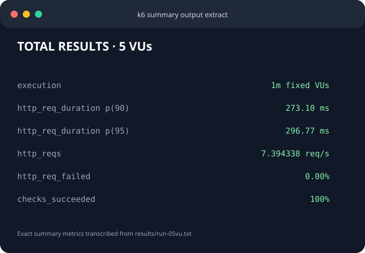
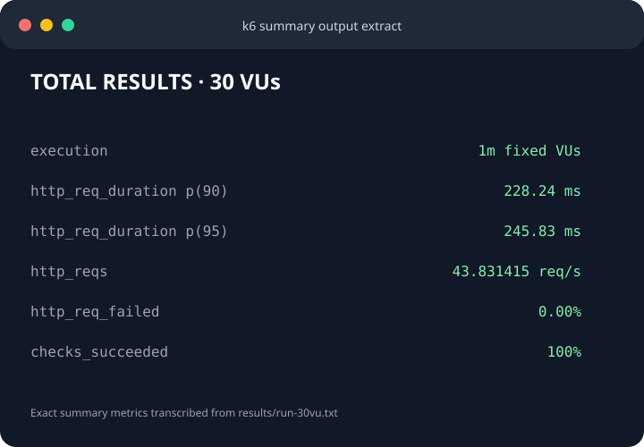
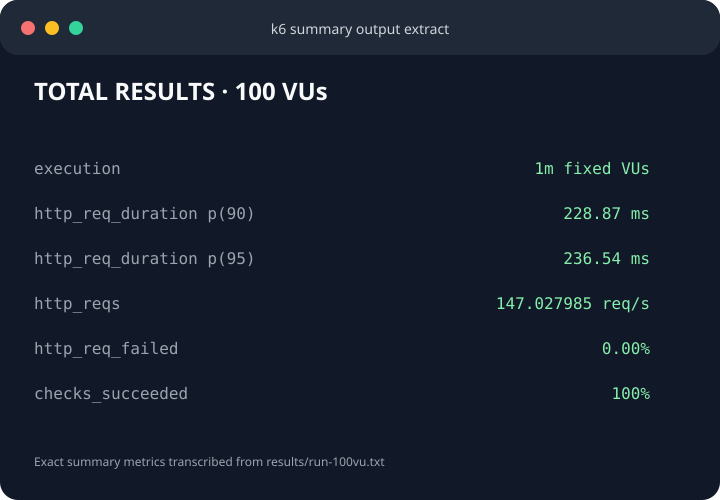

# Лаборатори №2 — k6 гүйцэтгэлийн хэмжүүр

F.CSA313, 2026. Энэ ажилд зөвхөн зааварт зөвшөөрсөн дадлагын хост `test.k6.io` болон өөрийн `127.0.0.1` локал серверийг туршсан.

## Орчин ба target

- OS: Ubuntu Linux x86_64
- k6: `k6 v2.4.0 (commit/dd9395906d, go1.26.11, linux/amd64)` — бүтэн гаралт: [`results/k6-version.txt`](results/k6-version.txt)
- Үндсэн target: `https://test.k6.io/`
- 2026-11-24-нд `test.k6.io` нь QuickPizza дадлагын хост руу HTTP 302 redirect хийж байв. Скрипт зөвхөн үндсэн URL-д GET хүсэлт явуулна; k6 redirect-ийг дагадаг учир `http_reqs` нь iteration тутмын хоёр HTTP хүсэлтийг тоолдог.

## Скриптүүд

- [`scripts/load-test.js`](scripts/load-test.js) — үндсэн 5 VU, 30 секундийн тест; CLI-аар VU/хугацааг өөрчилнө.
- [`scripts/stages.js`](scripts/stages.js) — 5 → 30 → 100 VU шатлал, буултын хамт.
- [`scripts/local-server.js`](scripts/local-server.js) — өөрийн `127.0.0.1:4173` сервер; `/slow` нь 100 ms хүлээнэ.
- [`scripts/thresholds-pass.js`](scripts/thresholds-pass.js), [`scripts/thresholds-fail.js`](scripts/thresholds-fail.js) — локал серверийн SLO PASS/FAIL.

## Ажиллуулах

```bash
k6 run scripts/load-test.js | tee results/run-baseline-05vu.txt
k6 run --vus 5 --duration 1m scripts/load-test.js | tee results/run-05vu.txt
k6 run --vus 30 --duration 1m scripts/load-test.js | tee results/run-30vu.txt
k6 run --vus 100 --duration 1m scripts/load-test.js | tee results/run-100vu.txt
k6 run scripts/stages.js | tee results/run-stages.txt

# Хоёр дахь терминалд локал серверээ асаагаад:
node scripts/local-server.js
k6 run scripts/thresholds-pass.js | tee results/threshold-pass.txt
k6 run scripts/thresholds-fail.js | tee results/threshold-fail.txt
```

`results/` хавтас дахь файлууд нь k6-ийн бүтэн stdout гаралт. `screenshots/` дахь SVG summary зургууд нь эдгээр гаралтын үндсэн хэмжүүрийг уншихад хялбар байдлаар дүрсэлсэн.

## 5/30/100 VU хэмжилт

| VU | p90 latency (ms) | p95 latency (ms) | Throughput (http_reqs/s) | Error rate |
|---:|---:|---:|---:|---:|
| 5 | 273.10 | 296.77 | 7.394338 | 0.00% |
| 30 | 228.24 | 245.83 | 43.831415 | 0.00% |
| 100 | 228.87 | 236.54 | 147.027985 | 0.00% |

Эх сурвалж: [`run-05vu.txt`](results/run-05vu.txt), [`run-30vu.txt`](results/run-30vu.txt), [`run-100vu.txt`](results/run-100vu.txt). Эдгээр нь тус бүр 1 минутын тусдаа ажиллуулалтын бүтэн гаралт. 5 VU baseline-ийн 30 секундын гаралт [`run-baseline-05vu.txt`](results/run-baseline-05vu.txt)-д бий (p95 = 316.66 ms). Stages-ийн нэгтгэсэн гаралт [`run-stages.txt`](results/run-stages.txt)-д хадгалагдсан.

## SLO ба threshold үр дүн

Baseline p95 = 316.66 ms тул SLO-ийн latency босгыг baseline × 1.5 = 474.99 ms гэж тооцоод 475 ms болгож дугуйлав. Мөн хүсэлт амжилтгүй болох хувь 1%-иас бага байх шаардлага тавив. PASS хувилбар эдгээр босгыг 100 ms хүлээлгэдэг өөрийн локал `/slow` endpoint дээр шалгасан: p95 = 102.94 ms, error rate = 0%, хоёр босго биелсэн. FAIL хувилбарт `p(95)<0.01` ms гэсэн зориуд биелэхгүй босго тавихад хэмжсэн p95 = 2.77 ms болж босго унасан. Бүрэн гаралтууд: [`threshold-pass.txt`](results/threshold-pass.txt), [`threshold-fail.txt`](results/threshold-fail.txt).

## Дүгнэлт

5 VU үед p95 latency 296.77 ms, хүсэлтийн хурд 7.39 req/s байв. 30 VU болоход p95 245.83 ms болж, throughput 43.83 req/s хүртэл нэмэгдсэн. 100 VU үед p95 236.54 ms, throughput 147.03 req/s болсон. Энэ хэмжилтийн хүрээнд зэрэгцээ хэрэглэгч нэмэгдэхэд latency өссөн шинж ажиглагдаагүй. Харин throughput өссөн нь илүү олон хүсэлтийг нэг секундэд боловсруулж байгааг харууллаа. Гурван түвшинд HTTP алдааны хувь 0% байсан тул туршилтын явцад алдаа ажиглагдсангүй. Stages туршилт ачааллыг 5-аас 100 VU хүртэл өсгөж буулгасан бөгөөд нийт p95 нь 227.39 ms байв. Baseline p95-д суурилсан 475 ms SLO локал 100 ms endpoint-ийн PASS туршилтаар хангагдсан. Харин зориуд хатуу 0.01 ms threshold FAIL болсон нь k6-ийн threshold quality gate хэрхэн ажилладгийг харуулав.

## Үр дүнгийн дүрс







## Коммитын явц

Ажлыг хэд хэдэн үе шатанд хувааж, коммитуудын хооронд 10 минутаас илүү хугацаа баримталсан.
